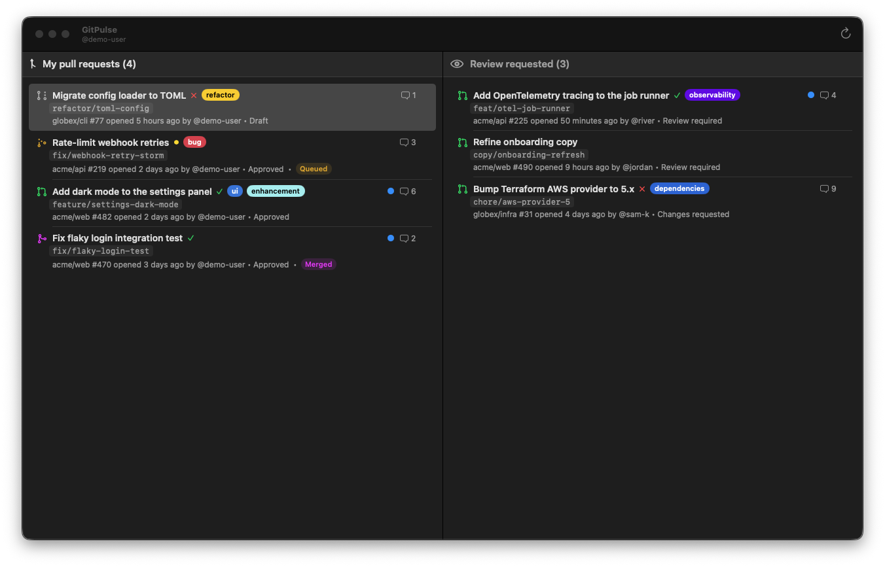

# GitPulse

[](https://github.com/drosam/gitpulse/actions/workflows/ci.yml)   [](LICENSE)

A small native macOS menu bar app that tracks your work on GitHub in one window:

- **My pull requests** — open PRs you authored or are assigned to, plus unread merged PRs until opened
- **Review requested** — open PRs waiting for your review, plus PRs you commented on or reviewed until you approve them; PRs already in **My pull requests** stay only there



Native Swift and SwiftUI, no Electron, no servers, no telemetry. GitPulse talks only to GitHub.

## Install

> **Unsigned build.** GitPulse is not notarized by Apple. The Homebrew cask removes the quarantine flag for you. With the DMG or ZIP, right-click **GitPulse.app** and choose **Open** the first time.

Requires macOS 15 (Sequoia) or later. Releases are universal (Apple silicon and Intel).

### Homebrew (recommended)

```sh
brew install --cask drosam/tap/gitpulse
```

Upgrade with `brew upgrade --cask gitpulse`.

### Download

1. Download `GitPulse-<version>.dmg` or `.zip` and `SHA256SUMS.txt` from the [latest release](https://github.com/drosam/gitpulse/releases/latest), then verify:

   ```sh
   grep "GitPulse-<version>.zip" SHA256SUMS.txt | shasum -a 256 -c
   gh attestation verify GitPulse-<version>.zip --repo drosam/gitpulse
   ```

   The attestation proves the file was built by this repository's release workflow.
2. Drag **GitPulse.app** to `/Applications`.
3. First launch only: right-click **GitPulse.app** → **Open**, or run:

   ```sh
   xattr -dr com.apple.quarantine /Applications/GitPulse.app
   ```

### Build from source

Requires full Xcode 16 or later, selected with `sudo xcode-select -s /Applications/Xcode.app/Contents/Developer`. Command Line Tools alone are not enough: CLT 27 does not ship the plugin SwiftUI needs for `@State`.

```sh
git clone https://github.com/drosam/gitpulse.git
cd gitpulse
make install
open -a GitPulse
```

This builds a release binary for your Mac, generates the icon, and installs an ad-hoc signed `/Applications/GitPulse.app`. Source builds show `dev (<commit>)` as their version. If GitPulse is already installed with Homebrew, `make install` refuses; use `make dev` to run your build in place instead.

## Features

- Two-pane dashboard, refreshed automatically every 2 minutes (`⌘R` to refresh manually); automatic refresh pauses until GitHub's rate limit resets if it runs out
- Pull request lists default to created newest-to-oldest; Settings can switch to updated newest-to-oldest
- Click a row or press Return to open the selected PR in your browser
- Keyboard navigation: arrow keys move between rows/panes, `V` shows unread notification details for the selected PR, Space clears an unread dot, `⌘C` copies the selected PR URL, `H` hides/restores the selected PR, `⇧⌘H` (**View → Show Hidden Pull Requests**) toggles showing hidden PRs. Shortcuts apply only while the dashboard window has focus.
- Each row shows draft state, merged/merge-queue status, CI status (✓ / ✗ / running), head branch, labels, comment count, age, author, and review decision
- **Notifications** — GitPulse detects useful PR activity from the dashboard:
  - macOS banners for new review requests, new top-level comments, inline review-thread replies, submitted reviews, CI completion, merge-queue exits, and newly merged PRs you authored or were assigned to
  - Newly merged authored/assigned PRs stay in **My pull requests** with a purple merged icon and unread dot until you open them or press Space to dismiss
  - Optional sound
  - Optional blue unread dots in rows and the menu bar
  - Optional Dock badge count while anything is unread
- **Settings** (`⌘,` or menu bar icon → **Settings…**):
  - Show/hide notification banners
  - Turn notification sounds on/off
  - Show/hide Dock badge count
  - Show/hide unread dots
  - Start GitPulse automatically when you log in
  - Check all matching repositories or only selected repositories (`owner/repo` or GitHub URLs)
  - Show hidden pull requests in lists
  - Restore hidden pull requests
- Lives in the menu bar: closing the window hides the Dock icon, the app keeps polling in the background
- The menu bar menu shows the running version

## Review requests

- **Review requested** includes open PRs where GitHub is requesting your review.
- If you leave comments or request changes, GitPulse keeps the PR in the list until you approve it or the PR closes/merges.
- PRs you authored or are assigned to stay only in **My pull requests**, even if you commented on them.
- Approved PRs are removed from **Review requested** unless GitHub requests your review again.

## Merged pull requests

- When a PR you authored or are assigned to merges, GitPulse keeps it temporarily in **My pull requests**.
- Merged rows use GitHub's purple merge icon, show a **Merged** pill, and drive the row dot, menu bar dot, and Dock badge like other unread items.
- Open the row or its banner, or press Space, to clear it. Once cleared, the merged row is removed from the list.
- Merged PRs are never added to **Review requested**.

## Hiding pull requests

- Select a PR and press `H`, or right-click it and choose **Hide Pull Request**.
- Press `H` on a hidden PR, or right-click it and choose **Restore Pull Request**, to restore it.
- Press `⇧⌘H`, or use **Settings… → Hidden Pull Requests → Show hidden pull requests in lists**, to show/hide hidden PRs in the dashboard.
- When shown, hidden PRs move to the bottom of each list, keep their relative order, and are dimmed and marked **Hidden**.
- Hidden PRs can still show a row-level blue unread dot, but they do not drive the menu bar dot, Dock badge, notification banners, or sounds.
- Restore one or all hidden PRs from **Settings… → Hidden Pull Requests**.
- Hidden PRs, unread dots, and notification history are kept per GitHub account, so switching accounts restores each account's own state. Signing out clears the signed-in account's state.

## Troubleshooting

**`Refusing to load cask drosam/tap/gitpulse from untrusted tap`.** Homebrew 6 only loads third-party taps you trust. Run `brew trust drosam/tap`, then retry.

**"GitPulse can't be opened" / "is damaged".** The app is unsigned. Install with Homebrew, or run `xattr -dr com.apple.quarantine /Applications/GitPulse.app`.

**No notification banners.** Allow GitPulse in System Settings → Notifications. GitPulse shows a banner in its window when permission is denied.

## Authentication

GitPulse resolves a GitHub token in this order:

1. `GITHUB_TOKEN` environment variable
2. macOS Keychain (saved by a previous sign-in)
3. `gh auth token` (if the GitHub CLI is installed and logged in)
4. OAuth device flow — click **Sign in with GitHub**, enter the code shown

The device flow uses a registered OAuth app (client ID in `Sources/GitPulse/GitHub/DeviceFlow.swift`). No client secret is needed or shipped; tokens are stored only in the Keychain.

The token needs the `repo` scope (covers private-repo search) and `read:org` (lets search see org PRs). GitPulse only reads; it never writes to GitHub. Classic personal access tokens with those scopes also work via `GITHUB_TOKEN`.

**Settings… → Account** shows the signed-in login, where the token comes from, and **Sign Out**. Signing out deletes the Keychain token and this account's hidden and unread state, and GitPulse stays signed out across relaunches even if `GITHUB_TOKEN` or `gh` still has a token; the sign-in screen then offers **Use GITHUB_TOKEN** or **Use GitHub CLI Token** to sign back in with it. Signing out doesn't revoke GitPulse's access on GitHub: revoke it under **Authorized OAuth Apps** at [github.com/settings/applications](https://github.com/settings/applications).

## Privacy

- The token stays in your environment, your login Keychain, or the GitHub CLI's store.
- Network requests use no disk cache or cookie store, so the token and responses are never written to `~/Library/Caches` or `~/Library/HTTPStorages`.
- GitPulse sends requests only to `api.github.com` (GraphQL) and `github.com` (device-flow sign-in).
- No analytics, telemetry, or third-party services.
- Notification state and settings live in `~/Library/Preferences/dev.davidrosa.gitpulse.plist`.
- Links are opened only when they point to `https://github.com`, including the sign-in page GitHub sends during device flow. The one exception is the fixed link to macOS **System Settings → Notifications**.

See [SECURITY.md](SECURITY.md) to report a vulnerability.

## Demo mode

Launch with fictional data, without signing in, network access, or notifications:

```sh
open -a GitPulse --args --demo
```

Demo mode keeps its preferences separate from your real ones. It is used for the screenshot above.

## Uninstall

1. Remove the token GitPulse saved in the Keychain, if you used **Sign in with GitHub**:

   ```sh
   security delete-generic-password -s dev.davidrosa.gitpulse.github-token
   ```

2. Remove the app:

   ```sh
   brew uninstall --zap --cask gitpulse   # Homebrew
   make uninstall                          # source install
   ```

`--zap` also deletes preferences, saved window state and the network cache that v0.1.0 wrote.

3. After `make uninstall`, delete the same files by hand:

   ```sh
   rm -rf ~/Library/Caches/dev.davidrosa.gitpulse ~/Library/HTTPStorages/dev.davidrosa.gitpulse*
   defaults delete dev.davidrosa.gitpulse
   ```

## Contributing

Issues and pull requests are welcome. See [CONTRIBUTING.md](CONTRIBUTING.md).

## License

[MIT](LICENSE) © David Rosa Moncayo
